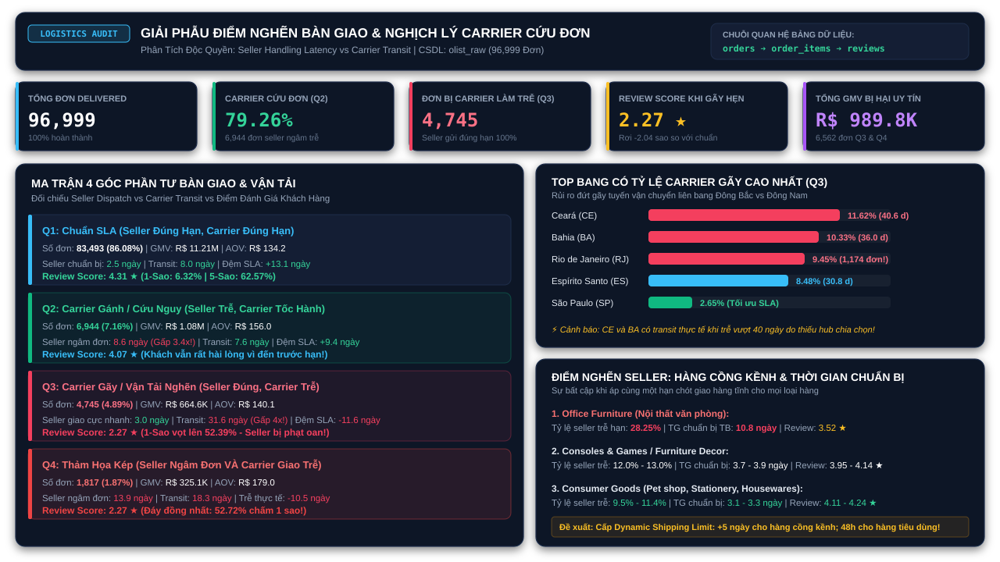

<div align="center">

# Olist-Analysis-AI-Agent-Assitance

**Diagnostic analytics engine, 20 domain skills, and interactive HTML/BI cockpits for the Olist e-commerce dataset.**

[](https://github.com/doducanhkhoi-ops/Olist-Analysis-AI-Agent-Assitance/actions/workflows/ci.yml)
[](https://github.com/doducanhkhoi-ops/Olist-Analysis-AI-Agent-Assitance/actions/workflows/codeql.yml)
[](https://www.python.org/downloads/)
[](./LICENSE)

</div>

---

Combines a 6-step diagnostic analytics workflow (`AnalyticFlow.md`), Power BI / MySQL data generators, and self-contained HTML executive cockpits.



---

## Why Olist-Analysis-AI-Agent-Assitance?

- **6-step diagnostic flow**: Enforces symptom → multi-dimensional hypothesis → data slicing → paradox resolution → root cause → quantified recommendation.
- **20 specialized skills**: Covers SQL optimization, data QA, financial modeling, churn prevention, Power BI authoring, and executive storytelling under `.agents/skills/`.
- **4 HTML cockpits**: Interactive freight deadweight, fulfillment handover, payment financing, and year-end logistics diagnostics.
- **Automated BI builders**: Python generators for `.xlsx` workbooks and `.pbip` Power BI projects.

---

## Feature Overview

| Component | Behavior |
| --- | --- |
| **Diagnostic Rules** (`AnalyticFlow.md`, `GEMINI.md`) | Enforces anti-hallucination data QA and structured root-cause analysis |
| **Data & BI Generators** (`generate_*.py`, `build_*.py`) | Queries MySQL (`check_db_connection.py`) and builds `.xlsx` / `.pbip` outputs |
| **HTML Cockpits** (`*_Cockpit.html`, `*_diagnostic.html`) | Standalone browser dashboards for freight, fulfillment, and payment diagnostics |
| **Agent Skills** (`.agents/skills/`) | 20 modular `SKILL.md` playbooks for analytics and BI tooling |

---

## Quick Start

```bash
git clone https://github.com/doducanhkhoi-ops/Olist-Analysis-AI-Agent-Assitance.git
cd Olist-Analysis-AI-Agent-Assitance
pip install -r requirements.txt
cp .env.example .env
python check_db_connection.py
```

---

## Testing & Security

```bash
python -m unittest discover -s tests -v
```

| Check | Tool | Scope |
| --- | --- | --- |
| **Integrity & Syntax** | `pytest` (`3.10`, `3.11`, `3.12`) | Bytecode compile on all `.py` scripts, HTML cockpit validation, `SKILL.md` presence |
| **SAST** | GitHub CodeQL | Static vulnerability analysis on Python source |

---

## License

[Apache License 2.0](./LICENSE)
